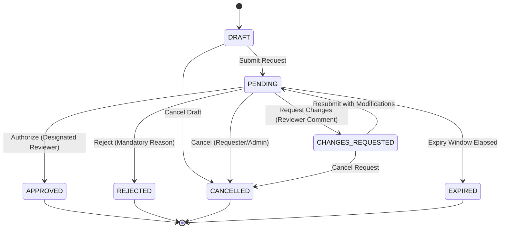

# BIOS — Milestone 4: Human Approval, Decision Workflow & Audit Intelligence

## 1. Overview & Objectives

Milestone 4 implements a backend-enforced **human-in-the-loop approval and immutable audit system** for BIOS.
The system guarantees that:
- AI agents propose recommendations and identify rationalisation opportunities, but **cannot independently authorize or execute consequential changes**.
- Every consequential action (retirement, consolidation, migration, model/KPI adjustments, artifact publication, governance exceptions) requires human sign-off by designated roles.
- Hard governance blockers (e.g. active downstream dependencies, unapproved critical KPIs) strictly prevent approval unless a formal exception review is performed by a BI Governance Reviewer.
- Self-approval and AI-agent authorizations are strictly prohibited.
- An append-only, immutable audit log permanently records every action, before/after state snapshot, reason, and actor identity.

---

## 2. Role and Responsibility Model (RBAC)

| Role | Operational Scope & Authority | Actions Authorized |
|---|---|---|
| **`BI_GOVERNANCE_REVIEWER`** | Central BI & Compliance Authority. Authorizes high-risk lifecycle changes, retirement of endorsed content, and governance exception overrides. | `RETIRE`, `GOVERNANCE_EXCEPTION`, `PUBLISH_ARTIFACT` (certified), `CONSOLIDATE`, `MIGRATE`, `CHANGE_MODEL`, `CHANGE_KPI` |
| **`DOMAIN_STEWARD`** | Commercial, Supply Chain, and Market Access domain stewards. Authorizes KPI definition alignments and semantic model schema modifications. | `CHANGE_KPI`, `CHANGE_MODEL`, `MIGRATE`, `CONSOLIDATE` |
| **`ASSET_OWNER`** | Accountable business or technical asset custodian. Reviews consolidation and publication for assets within their ownership scope. | `CONSOLIDATE`, `PUBLISH_ARTIFACT` (standard) |
| **`BIOS_ADMIN`** | Platform administrator. Manages configuration, approval queues, and cancellations; does **not** unilaterally approve domain business actions. | `MIGRATE`, `PUBLISH_ARTIFACT`, request cancellation |
| **`REQUESTER`** | Business users and analytics requesters. Can submit approval requests and view status; **strictly barred from self-approval**. | *None (Submission only)* |

### Enforced Security Safeguards:
1. **Anti-Self-Approval Ban**: Requesters cannot approve their own requests (`actor_id != requester_id`).
2. **AI Agent Authorization Ban**: AI agents or automated bots cannot sign off on approval requests (`actor_id` containing `agent`, `bot`, or `ai` is rejected with `403 Forbidden`).
3. **Hard Governance Blocker Veto**: If an approval request contains active governance blockers (e.g., downstream reports depend on the asset), standard approval is blocked with `422 Unprocessable Content`. Only formal `GOVERNANCE_EXCEPTION` reviewed by a `BI_GOVERNANCE_REVIEWER` can proceed.

---

## 3. Finite State Machine & Valid Transitions



- **Terminal States**: `APPROVED`, `REJECTED`, `CANCELLED`, and `EXPIRED` have zero outbound transitions. Attempting to modify them results in `422 Unprocessable Content`.
- **Mandatory Decision Comments**: Rejecting or requesting changes requires a substantive comment ($\ge 5$ characters).

---

## 4. Intelligent Routing Rules

Requests are dynamically routed to the required reviewer role based on multi-dimensional risk:

- `RETIRE`:
  - If asset is endorsed (`certified`/`promoted`), reaches $\ge 500$ users, or has downstream dependent reports $\rightarrow$ **`BI_GOVERNANCE_REVIEWER`**.
  - If unendorsed and low audience without dependents $\rightarrow$ **`ASSET_OWNER`**.
- `GOVERNANCE_EXCEPTION` $\rightarrow$ **`BI_GOVERNANCE_REVIEWER`**.
- `CHANGE_KPI` $\rightarrow$ **`DOMAIN_STEWARD`**.
- `CHANGE_MODEL` $\rightarrow$ **`DOMAIN_STEWARD`**.
- `MIGRATE`:
  - High technical complexity or high business value $\rightarrow$ **`BI_GOVERNANCE_REVIEWER`**.
  - Standard complexity $\rightarrow$ **`DOMAIN_STEWARD`**.
- `PUBLISH_ARTIFACT`:
  - Certified or high reach ($\ge 500$) $\rightarrow$ **`BI_GOVERNANCE_REVIEWER`**.
  - Standard delivery $\rightarrow$ **`ASSET_OWNER`**.

---

## 5. Append-Only Audit Trail

Every lifecycle event appends an immutable record to the `audit_events` table:

```json
{
  "event_id": "AUD-20261107062834-4C2E9A",
  "actor_id": "reviewer_sarah",
  "actor_role": "BI_GOVERNANCE_REVIEWER",
  "event_type": "APPROVAL_GRANTED",
  "target_entity_type": "asset",
  "target_entity_id": "AST-0050",
  "action": "APPROVE_CONSOLIDATE",
  "before_state_json": "{\"status\": \"PENDING\"}",
  "after_state_json": "{\"status\": \"APPROVED\", \"decided_by\": \"reviewer_sarah\"}",
  "reason": "Authorized: Deduplication verified against target model.",
  "associated_recommendation_id": "REC-0012",
  "created_at": "2026-11-07T06:28:34.120482Z"
}
```

---

## 6. API Endpoints

Mounted under `/api/v1/approvals` and `/api/v1/audit`:

| Method | Endpoint | Description |
|---|---|---|
| `POST` | `/api/v1/approvals` | Submit approval request with target entity, evidence snapshot, and blockers. |
| `GET` | `/api/v1/approvals` | List approval requests with pagination and filters (`status`, `required_role`, `requester_id`). |
| `GET` | `/api/v1/approvals/summary` | Queue summary metrics (pending by role, approved, rejected, expired). |
| `GET` | `/api/v1/approvals/{id}` | Inspect single approval details. |
| `POST` | `/api/v1/approvals/{id}/approve` | Approve request (enforces RBAC, anti-self-approval, blocker vetoes). |
| `POST` | `/api/v1/approvals/{id}/reject` | Reject request with mandatory reason. |
| `POST` | `/api/v1/approvals/{id}/request-changes` | Request modifications with reviewer feedback. |
| `GET` | `/api/v1/approvals/{id}/history` | Retrieve full state transition timeline. |
| `GET` | `/api/v1/audit/events` | Retrieve append-only immutable audit trail. |

---

## 7. Test Suite & Verification

The test suite contains **92 automated tests** executing in **~12 seconds**:
- `test_approvals_state_machine.py` (3 tests): Valid transitions, terminal states, comment enforcement.
- `test_approvals_rbac.py` (4 tests): Role authority matrix, self-approval prevention, AI agent prohibition, governance blocker enforcement.
- `test_approvals_routing.py` (5 tests): Action-based and risk-based dynamic role routing.
- `test_audit_immutability.py` (1 test): Append-only audit trail logging across creation and decisions.
- `test_approvals_api.py` (4 tests): End-to-end API workflows, 403 Forbidden on self-approval, 422 on invalid transitions, queue summary.
- Backward compatibility: All 75 tests from Milestones 0, 1, 2, and 3 pass 100%.

