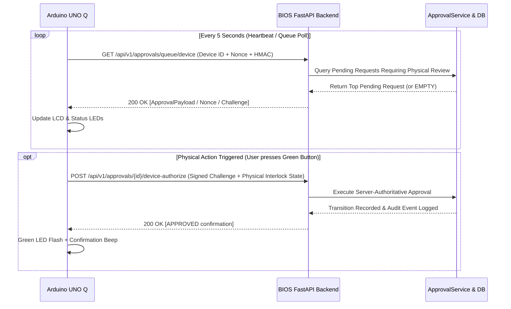

# BIOS — Arduino UNO Q Hardware Integration Architecture & Software Contract

> [!WARNING]
> **SUPERSEDED — SCOPE REFINEMENT (MILESTONE 5.7.2)**:
> Hardware integration (including the Arduino UNO Q / Arduino Edge companion device) has been completely removed from the active BIOS project scope.
> BIOS is an exclusively software-based enterprise platform. This document is retained solely for historical architecture reference.

**Document Version**: 1.0.0 (Milestone 5.6 Preparation — Superseded at Milestone 5.7.2)  
**Target Milestone for Physical Integration**: Superseded / Removed  
**Status**: Archived Historical Reference (Software-Only Scope Adopted)  
**Author**: BIOS System Architecture Team  

---

## 1. Executive Summary & Architectural Positioning

The Arduino UNO Q integration provides a tangible, physical-world manifestation of the **human-in-the-loop governance principle** within the BIOS (Business Intelligence Optimization System) platform. It embodies consequential analytics governance: AI agents can synthesize, discover, analyze, and recommend actions, but consequential lifecycle changes (asset retirement, unendorsed high-reach waivers, Tableau-to-Power BI migration authorization) require an explicit, physical human touchpoint.

> [!IMPORTANT]
> **Non-Authoritative Boundary**: The Arduino device is an **input and physical telemetry periphery**, NOT an independent authorization authority. A displayed approval code or device push does not independently grant permissions. All requests submitted via hardware must be validated server-side by `ApprovalService` against the authoritative database, verifying RBAC permissions, live owner status, synchronous waiver expirations, and governance blocker vetoes.

---

## 2. Hardware Bill of Materials (Milestone 6 Physical Kit)

| Component | Specification | Role in BIOS System |
|---|---|---|
| **Microcontroller Board** | Arduino UNO Q / Arduino UNO R4 WiFi | Core compute, TLS networking, I/O controller, cryptographic HMAC signer |
| **Status Display** | 20x4 Character LCD (I2C) or 0.96" OLED (SSD1306) | Displays pending approval ID, target asset, action type, requester, and confidence |
| **Governance Status LEDs** | 3x 5mm LEDs (or 1x Common Cathode RGB) | Visual state indicator (Green = Active/Clean, Amber = Pending Human Review, Red = Governance Blocker / Veto) |
| **Physical Approval Controls** | 2x Industrial Tactile Pushbuttons | Green button = Authorize / Advance; Red button = Reject / Veto |
| **Safety Interlock** | 2-Position Key Switch or Covered Toggle | Consequential Action Interlock (Required to authorize RETIRE or GOVERNANCE_EXCEPTION) |
| **Audible Indicator** | Piezo Buzzer (5V Active) | Short beep on new approval arrival; warning warble on governance veto |

---

## 3. Communication Protocol & Telemetry Contract

### 3.1 Device Polling & Heartbeat Loop
The device communicates with the BIOS FastAPI backend over HTTPS/REST (with optional WebSocket/SSE support in Milestone 6):



### 3.2 Polling Endpoint Payload Schema (`GET /api/v1/approvals/queue/device`)

#### Request Headers:
```http
X-BIOS-Device-ID: ARD-UNO-Q-001
X-BIOS-Timestamp: 2026-11-07T10:15:30Z
X-BIOS-Nonce: 4f9e8a2b1c7d3e5f
X-BIOS-Signature: a3f88c7d8123... (HMAC-SHA256 of DeviceID + Nonce + Timestamp)
```

#### Response Payload (`200 OK` - Pending Item):
```json
{
  "queue_status": "PENDING_APPROVAL",
  "pending_count": 3,
  "top_item": {
    "approval_id": "APR-202611071015-A1B2C3",
    "action_type": "MIGRATE",
    "target_entity_type": "asset",
    "target_entity_id": "AST-0050",
    "target_entity_name": "Eylea Regional Sales",
    "requester_id": "OWN-001",
    "requester_name": "Nina Garcia",
    "required_role": "BI_GOVERNANCE_REVIEWER",
    "confidence_score": 0.88,
    "has_blockers": false,
    "challenge_nonce": "c9a4128f-7d1a-4b21-a3f2-1084ef817c32",
    "expires_at_epoch": 1794046530
  }
}
```

#### Response Payload (`200 OK` - Queue Clean):
```json
{
  "queue_status": "CLEAN",
  "pending_count": 0,
  "system_state": "GOVERNANCE_NOMINAL",
  "top_item": null
}
```

---

## 4. Physical Display & Visual Mapping Contract

### 4.1 LED Status Indicator States
| LED Pattern | Governance / System State | LCD Line 1-2 Display | Operator Meaning |
|---|---|---|---|
| **Steady Green** | Nominal / Zero Pending | `BIOS NOMINAL` / `Estate Governed` | All analytics assets governed; no approvals pending |
| **Pulsing Amber** | Review Required | `PENDING: [APR-ID]` / `[ACTION] [ASSET]` | Consequential action waiting for human adjudication |
| **Flashing Red** | Blocker / Veto Active | `GOV BLOCKER VETO` / `Rule: RULE-003/005` | Active rule violation; unendorsed high reach or broken lineage |
| **Rapid Amber Flash** | Interlock Missing | `ENGAGE SAFETY KEY` / `Action Restricted` | High-risk action attempted without turning physical safety key |
| **Alternating Blue/Red** | Stale / Disconnected | `DISCONNECTED` / `Reconnecting...` | Network connection lost; physical buttons disabled |

### 4.2 20x4 Character LCD Layout
```text
+--------------------+
|BIOS v5.6 [PENDING] | <- System status & queue state
|APR: APR-2026110701 | <- Truncated Approval ID
|MIGRATE AST-0050    | <- Action & Target Asset
|[CONF:88%] [G:OK/R:X| <- Confidence & Button Prompts
+--------------------+
```

---

## 5. Security Architecture & Replay Protection

### 5.1 Mutual Authentication & Signatures
1. **Shared Secret**: Each physical device has a pre-shared 256-bit cryptographic secret (`DEVICE_SHARED_SECRET`) injected into micro-controller flash memory during commissioning.
2. **Request Signing**: Every outgoing message from the Arduino includes an HMAC-SHA256 signature calculated over `HTTP_METHOD + PATH + TIMESTAMP + NONCE + BODY`.
3. **Server Verification**: The backend validates the signature, rejects clocks skewed by $>30$ seconds, and verifies the one-time `NONCE`.

### 5.2 One-Time Challenge & Physical Authorization (`POST /api/v1/approvals/{id}/device-authorize`)
When the physical button is pressed:
1. The device reads the `challenge_nonce` received in the polling payload.
2. The device verifies the physical state of the safety interlock switch.
3. The device constructs the authorization payload:
   ```json
   {
     "device_id": "ARD-UNO-Q-001",
     "approval_id": "APR-202611071015-A1B2C3",
     "decision": "APPROVED",
     "challenge_nonce": "c9a4128f-7d1a-4b21-a3f2-1084ef817c32",
     "safety_interlock_engaged": true,
     "operator_badge_id": "GOV-OFFICER-01",
     "button_press_duration_ms": 420
   }
   ```
4. **Backend Nonce Invalidation**: Once processed, `challenge_nonce` is burned immediately. Replaying the payload triggers `403 Forbidden (Replay Attack Detected)`.

---

## 6. Offline & Error Recovery Guarantees

1. **Heartbeat Timeout ($>15$ seconds)**:
   - If the Arduino fails to receive a successful heartbeat response for 3 consecutive polls (15s):
   - The display enters **`OFFLINE / STALE DATA`** state.
   - All physical approval buttons are **inhibited in hardware/firmware**.
   - No cached approval can be submitted while disconnected.
2. **Network Reconnection**:
   - On reconnection, the device resets internal state, requests a fresh queue snapshot, and obtains new challenges.
3. **Backend Authoritative Control**:
   - If a request was approved or rejected via the Web UI while the device was disconnected, the device's stale view is immediately overwritten upon the next poll.

---

## 7. Milestone 6 Readiness Checklist

- [x] REST communication schemas defined.
- [x] Mutual authentication (HMAC-SHA256 + nonce) specified.
- [x] Hardware Bill of Materials selected.
- [x] LED, buzzer, and LCD visual state mappings documented.
- [x] Physical interlock safety mechanism designed.
- [x] Server-authoritative approval boundary protected.
- [x] Replay attack and offline stale-cache mitigations defined.
- [ ] Physical firmware flashed to Arduino UNO Q (Milestone 6 implementation).
- [ ] End-to-end hardware loopback bench test (Milestone 6 implementation).

