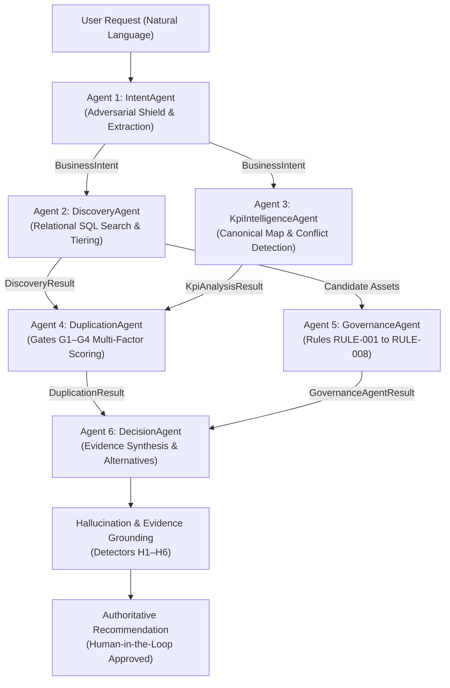

# BIOS — Milestone 5.9: Six-Agent Intelligence & Evidence Grounding Architecture

**Document ID**: `BIOS-ARCH-5-9-AGENT-INTELLIGENCE`  
**Milestone**: 5.9 — AI Intelligence Quality, Decision Accuracy & Optimization  
**Date**: November 7, 2026  
**Audience**: Enterprise AI Architects, Backend Engineers, BI Governance Leads  

---

## 1. Architectural Philosophy: Deterministic Authority with AI Intelligence

The central architecture of BIOS is built upon a fundamental enterprise principle:

> **LLMs propose and explain; deterministic rules, relational records, and human authorities decide.**

BIOS utilizes AI models (specifically local Ollama `qwen3.5:4b` or provider adapters) to assist in natural language intent understanding, semantic metric extraction, and business rationale drafting. However, all business rules, catalog lookups, duplication gates, ownership verifications, and lifecycle approvals are strictly governed by deterministic Python algorithms and ACID-compliant relational transactions.



---

## 2. Six Specialized Agents: Responsibilities & Boundaries

| Agent | Core Responsibility | Deterministic Responsibility | AI / LLM Responsibility |
| :--- | :--- | :--- | :--- |
| **Agent 1: IntentAgent** | Natural language query parsing & normalization | Regex catalog matching, adversarial injection detection (`ADVERSARIAL_OVERRIDE_PATTERNS`), geography ambiguity detection | Entity disambiguation assistance, multi-phrase dimension extraction |
| **Agent 2: DiscoveryAgent** | Enterprise catalog search across assets & models | Exact and partial SQL queries across 360 assets and 75 models; scoring penalties for scope mismatch; missing evidence tracking | Contextual keyword relevance ranking assistance |
| **Agent 3: KpiIntelligenceAgent** | Canonical KPI reconciliation & conflict detection | Authoritative lookup against `kpi_catalog`; canonical variant precedence (`KNOWN_VARIANT_CANONICAL_MAP`); formula validation | Natural language measure alias mapping suggestions |
| **Agent 4: DuplicationAgent** | Multi-factor duplicate assessment & scope gating | Gates G1–G4: Scope compatibility veto, Jaccard concept overlap, Gate G3 metric drift detection, structural lineage evaluation | Qualitative semantic similarity assessment |
| **Agent 5: GovernanceAgent** | Corporate BI policy enforcement | Strict evaluation of 8 deterministic rules (RULE-001 through RULE-008); N4 owner checks; N5 synchronous waiver expiry | Natural language governance finding explanations |
| **Agent 6: DecisionAgent** | Multi-agent synthesis & final recommendation | Selection of canonical decision path (`REUSE`, `CONSOLIDATE`, `MODIFY`, `MIGRATE`, `BUILD_NEW`, `NEEDS_CLARIFICATION`); security blocker generation; mandatory human approval enforcement | Executive business rationale drafting & narrative summarization |

---

## 3. Structured Handoff Contracts & Pydantic Schemas

Every handoff between agents is strongly typed using immutable Pydantic V2 models, ensuring that downstream agents never receive unvalidated or malformed state:

### 3.1 `BusinessIntent` (IntentAgent $\to$ Downstream)
```python
class BusinessIntent(BaseModel):
    raw_prompt: str
    products: List[str]
    markets: List[str]
    kpis: List[str]
    dimensions: List[str]
    time_periods: List[str]
    business_purpose: str
    ambiguities: List[EntityAmbiguity]
    confidence_score: float  # Capped at 0.40 on security override attempts
```

### 3.2 `DiscoveryResult` (DiscoveryAgent $\to$ Duplication / Governance / Decision)
```python
class DiscoveryResult(BaseModel):
    exact_matches: List[DiscoveredAsset]
    partial_matches: List[DiscoveredAsset]
    related_semantic_models: List[str]
    search_strategy: str
    missing_evidence: List[str]
    negative_evidence: List[str]
```

### 3.3 `DuplicationResult` (DuplicationAgent $\to$ DecisionAgent)
```python
class DuplicationResult(BaseModel):
    has_duplicates: bool
    duplicate_candidates: List[DuplicateCandidate]
    primary_duplicate_asset_id: Optional[str]
    explanation: str  # Reflects Gates G1–G4 outcomes
```

### 3.4 `GovernanceAgentResult` (GovernanceAgent $\to$ DecisionAgent)
```python
class GovernanceAgentResult(BaseModel):
    active_finding_ids: List[str]
    blockers: List[str]
    warnings: List[str]
    waivers_applied: List[str]
    out_of_scope_warnings: List[str]
```

### 3.5 `DecisionResult` (DecisionAgent Output)
```python
class DecisionResult(BaseModel):
    decision: DecisionType  # REUSE, CONSOLIDATE, MODIFY, MIGRATE, BUILD_NEW, NEEDS_CLARIFICATION
    confidence: float
    primary_recommendation: str
    rationale: str
    target_asset_ids: List[str]
    target_model_ids: List[str]
    alternatives: List[DecisionAlternative]
    blockers: List[str]
    warnings: List[str]
    human_approval_required: bool  # Strictly True on all consequential changes
    next_steps: List[str]
    active_finding_ids: List[str]
```

---

## 4. Evidence Grounding & Hallucination Defense (Detectors H1–H6)

Before any recommendation is finalized or returned via the API, the output must pass deterministic validation in `HallucinationDetector`:

1. **H1 — Phantom Asset Rejection**: Scans all output text and JSON payloads for regex patterns `AST-\d{4}`. Any ID not present in `analytics_assets` triggers an immediate rejection.
2. **H2 — Unapproved Metric Rejection**: Validates claimed KPI references (`KPI-\d{3}`) against `kpi_catalog`. Unapproved or fabricated metrics cannot be cited as canonical.
3. **H3 — Evidence Citation Integrity**: Validates that cited database tables and record IDs exist in physical SQLite tables.
4. **H4 — Semantic Model Verification**: Confirms claimed model IDs (`SM-\d{3}`) exist and match product scopes in `semantic_models`.
5. **H5 — Owner Grounding**: Confirms that cited owners exist in `owners` and possess `active` employment status.
6. **H6 — Migration Backlog Consistency**: Validates that legacy Tableau candidate migration recommendations match authentic records in `migration_backlog`.

---

## 5. Fallback Behavior & Graceful Degradation

If the local Ollama instance is offline or unreachable:
1. The orchestrator logs an honest provider degradation event (`DETERMINISTIC_FALLBACK`).
2. The pipeline routes through `DeterministicFallbackAdapter`.
3. Intent extraction executes via regex and catalog keyword tokenizers.
4. KPI mapping uses exact catalog token containment.
5. Duplication gates G1–G4 compute multi-factor scores purely from relational fields.
6. Decision synthesis uses deterministic decision tree rules.
7. Execution succeeds with zero crashes, preserving business continuity.

