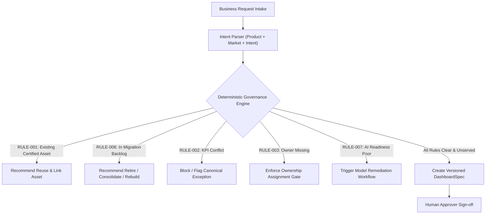

# BIOS — Comprehensive Data Quality and Governance Report
## Bayer Pharmaceuticals Builder Data Pack (Since AI 2026)

This report presents an in-depth audit of data quality, metadata integrity, and governance risks across the synthetic analytics estate in the challenge workbook (`data/source/Bayer_Pharmaceuticals_SinceAI_2026_FINAL_Builder_Data_Pack.xlsx`).

**Data provenance:** the dataset is entirely synthetic and was created by SinceAI, not Bayer. It contains no Bayer internal operational data, real patient information or confidential business records. Every count and finding in this report describes that synthetic data and must not be read as an actual Bayer operational result.

---

## Executive Summary

An automated profiling of all 8,148 non-empty data records across 24 worksheets confirmed that the estate exhibits classic symptoms of enterprise self-service BI sprawl:
1. **Unowned & Abandoned Analytics**: **21 production assets** have no assigned owner, and **65 active assets** are assigned to inactive personnel.
2. **KPI Governance Deficit**: Only **18 of 56 KPIs (32.1%)** have approved canonical status. The remaining 38 KPIs represent duplicate candidates, definition conflicts, or unapproved local variants.
3. **Asset Duplication & Sprawl**: **40 report titles are duplicated across 84 assets**, indicating redundant parallel builds by different business units.
4. **Migration Waste**: **36.2% of the Tableau migration backlog (34 of 94 assets)** should be retired or consolidated rather than migrated 1:1 into Power BI.
5. **AI Semantic Model Deficiencies**: **60.0% of semantic models (45 of 75)** fail full AI-readiness due to implicit measures, ambiguous date semantics, or poor technical naming.
6. **Benchmark Reconciliation**: BIOS profiling verified that all **147 declared defect records** in the `Data_Quality` catalog correspond exactly to active schema properties in `Semantic_Models` and `Analytics_Assets`, while independently uncovering systemic governance vulnerabilities not captured in the benchmark sheet.

---

## 1. Ownership Governance Deficiencies (RULE-003)

### 1.1 Unowned Production Assets (`owner_id IS NULL`)
In `Analytics_Assets`, exactly **21 out of 360 assets (5.8%)** lack an accountable owner (`owner_id IS NULL`).

- **Severity**: Critical (`high`). Direct violation of **RULE-003** (*"Production analytics need an accountable owner"*).
- **Audience Impact**: These 21 unowned assets expose an aggregate monthly audience of **12,410 estimated users**.
- **High-Risk Examples**:
  - `AST-0046` (*Lynkuet Supply - US*): **1,770 estimated audience**, `central_BI`, unowned.
  - `AST-0080` (*Eylea Executive Legacy*): **1,288 estimated audience**, `legacy`, unowned.
  - `AST-0060` (*Eylea Product Performance Copy*): **1,237 estimated audience**, `self_service`, unowned.
  - `AST-0026` (*Nubeqa Growth v2*): **609 estimated audience**, `business_managed`, unowned.
- **Audit Signal**: All 21 unowned assets trigger `signal_code = 'MISSING_OWNER'` in `Governance_Signals` and match the 21 defect records in `Data_Quality`.

### 1.2 "Ghost Ownership" — Assets Assigned to Inactive Personnel
Cross-referencing `Analytics_Assets.owner_id` with `Owners` (`status = 'inactive'`) reveals:
- **65 active assets** are assigned to owners who have left their roles or are marked `inactive` in the enterprise identity registry.
- **Risk**: Changes to upstream models or data quality incidents will fail notification routing, leaving reports unmaintained.
- **BIOS Action**: Flag assets assigned to inactive owners as `ORPHANED_STEWARDSHIP` requiring human workflow re-assignment.

---

## 2. Metric Consistency & KPI Governance (RULE-002)

### 2.1 The Canonical Illusion
In `KPI_Catalog`, all 56 records have `canonical_metric = True`. However, cross-checking `definition_status` and `approval_status` demonstrates significant fragmentation:

| Metric Definition Status | Count | % of Catalog | Definition & Operational Risk |
|--------------------------|-------|--------------|-------------------------------|
| `canonical` | 18 | 32.1% | Fully approved, standardized definition. Compliant with **RULE-002**. |
| `duplicate_candidate` | 16 | 28.6% | Redundant formulation of an existing metric (e.g., competing Margin or Variance DAX formulas). |
| `definition_conflict` | 13 | 23.2% | Conflicting business logic across departments (e.g., Gross-to-Net deductions). |
| `local_variant` | 9 | 16.1% | Non-standard market-specific modifications without central governance sign-off. |

### 2.2 Approval Deficit
Only **18 of 56 KPIs (32.1%)** hold `approval_status = 'approved'`:
- `local`: 19 KPIs (33.9%)
- `unapproved`: 11 KPIs (19.6%)
- `draft`: 8 KPIs (14.3%)

**Governance Finding**: Over **67% of cataloged KPIs in active reports lack formal enterprise approval**. When users prompt an AI assistant for a "finance dashboard" or "net sales report", returning unapproved or conflicting metric definitions introduces significant compliance and reporting risks.

---

## 3. Analytics Sprawl & Duplicate Detection (RULE-001)

### 3.1 Report Sprawl Ratio
- **Total Assets**: 360
- **Total Semantic Models**: 75
- **Sprawl Ratio**: **4.8 assets per semantic model**.
- **Delivery Model Split**:
  - `business_managed`: 143 (39.7%)
  - `central_BI`: 115 (31.9%)
  - `self_service`: 102 (28.3%)

### 3.2 Duplicate Asset Names
Exact name matching identified **40 unique asset titles reused across 84 separate assets**:

| Reused Asset Title | Asset Count | Asset IDs | Workspaces Involved | Upstream Models |
|--------------------|:-----------:|-----------|---------------------|-----------------|
| `Xarelto Budget New` | 3 | `AST-0001`, `AST-0067`, `AST-0099` | `WS-003`, `WS-012`, `WS-014` | `SM-001`, `SM-014`, `SM-022` |
| `Nubeqa Supply - US` | 2 | `AST-0009`, `AST-0358` | `WS-002`, `WS-010` | `SM-002`, `SM-074` |
| `All Pharma Net Sales New` | 2 | `AST-0015`, `AST-0262` | `WS-001`, `WS-008` | `SM-004`, `SM-055` |
| `All Pharma Launch - EMEA` | 2 | `AST-0016`, `AST-0321` | `WS-001`, `WS-013` | `SM-004`, `SM-067` |
| `Nubeqa Forecast Monthly` | 2 | `AST-0020`, `AST-0344` | `WS-002`, `WS-009` | `SM-005`, `SM-071` |

**Root Cause**: Local business units create copies of reports in regional workspaces (`WS-010`, `WS-012`, `WS-014`) rather than reusing central certified assets. When business requests arrive for these topics, BIOS must enforce **RULE-001** (*Reuse before build*).

---

## 4. Tableau to Power BI Migration Rationalization (RULE-006)

The estate contains **94 legacy Tableau workbooks** cataloged in `Migration_Backlog`.

### 4.1 Recommended Disposition Breakdown

```
       MIGRATE 1:1  [22]  (23.4%)  ████████████
            RETIRE  [22]  (23.4%)  ████████████
      HUMAN_REVIEW  [20]  (21.3%)  ███████████
REBUILD_ON_SHARED_MODEL [18] (19.1%) ██████████
CONSOLIDATE_BEFORE_MIGRATE [12] (12.8%) ███████
```

### 4.2 Eliminating Waste
- **22 assets (23.4%)** are earmarked for immediate **`RETIRE`** due to obsolete adoption or duplicate functionality.
- **12 assets (12.8%)** require **`CONSOLIDATE_BEFORE_MIGRATION`**.
- **18 assets (19.1%)** should not be migrated as standalone datasets, but rebuilt onto existing shared Power BI semantic models (**`REBUILD_ON_SHARED_MODEL`**).

**Quantified Value**: By enforcing **RULE-006** (*"Do not migrate waste"*), BIOS avoids migrating **52 unnecessary workbooks (55.3% of the backlog)**, significantly reducing project timeline, licensing costs, and cloud compute footprint.

---

## 5. Semantic Model AI Readiness & Technical Health (RULE-007)

Semantic models serve as the foundation for generative BI and agentic inquiry. Auditing the 75 models in `Semantic_Models` highlights critical friction points:

### 5.1 AI-Readiness Tiering
- **`good`**: 30 models (40.0%) — Explicit DAX measures, standard date tables, sanitized naming.
- **`partial`**: 24 models (32.0%) — Usable with prompt caveats; requires disambiguation.
- **`poor`**: 21 models (28.0%) — Blocked from autonomous agent interaction.

### 5.2 Semantics Flaw Distribution (`ai_issue_pattern`)
- **`clear`**: 27 models (36.0%) — No structural flaws.
- **`poor_names`**: 17 models (22.7%) — Technical database column names (e.g., `TXT_SLS_EUR_SYN`, `FCT_VAR_01`) that confuse natural-language engines.
- **`ambiguous_dates`**: 16 models (21.3%) — Missing standardized calendar tables or conflicting fiscal vs. calendar month keys.
- **`implicit_measures`**: 15 models (20.0%) — Aggregations rely on client-side visual calculation rather than explicit, version-controlled DAX definitions.

### 5.3 Scheduled ETL Refresh Health
- **`healthy`**: 42 models (56.0%)
- **`warning`**: 19 models (25.3%)
- **`failed`**: 14 models (18.7%)

**Risk**: 33 models (44.0%) have stale or unreliable refresh status. Reports consuming these models display outdated metrics without warning users.

---

## 6. Lineage Graph Integrity & The "SM-009" Gap (RULE-004)

`Lineage_Edges` contains 438 directed provenance edges:
- `MODEL_TO_ASSET`: 360 edges (100% of `Analytics_Assets` have an explicit upstream link).
- `ASSET_TO_ASSET`: 56 edges (composite dashboards and embedded apps).
- `MODEL_TO_MODEL`: 22 edges (shared enterprise data product dependencies).

### 6.1 The Disconnected Model: `SM-009`
Cross-referencing all 75 semantic models against `Lineage_Edges` revealed that **exactly one model is completely disconnected from the lineage graph**:
- **Model ID**: `SM-009`
- **Name**: *Gross-to-Net 09*
- **Workspace**: `WS-003` (*Cardiovascular Commercial*)
- **Product Scope**: *Hyrnuo* | **Region**: *Asia Pacific*
- **Health State**: Refresh `warning`, AI issue `ambiguous_dates`.
- **Finding**: While `Analytics_Assets` points `AST-0009` to `SM-002`, `SM-009` has zero downstream asset edges and zero upstream model edges in `Lineage_Edges`.
- **Recommendation**: Catalog `SM-009` as an orphaned semantic model candidate for retirement or graph repair.

---

## 7. Telemetry & User Experience Issues

Analysis of 3,600 historical monthly telemetry rows (`Asset_Usage`) revealed:
- **Visual Query Failures**: **207 assets experienced > 10 query errors** over the 10-month evaluation period. High failure rates correlate strongly with semantic models having `refresh_status = 'failed'` and `implicit_measures`.
- **Performance Latency**: Page render load times range from 420 ms up to **8,950 ms (nearly 9 seconds)**. 48 assets exceed 3,500 ms average load times, primarily on models with > 20 tables and unoptimized composite relationships.

---

## 8. Reconciliation with Benchmark `Data_Quality` Sheet

The workbook's `Data_Quality` sheet logs 147 pre-identified defect records:

| Defective Sheet | Target Field | Issue Value | Count | Verification Methodology & Result |
|-----------------|--------------|-------------|:-----:|:----------------------------------|
| `Semantic_Models` | `ai_issue_pattern` | `poor_names`, `implicit_measures`, `ambiguous_dates` | 48 | **Verified**: Exactly matches all models where `ai_issue_pattern != 'clear'`. |
| `Semantic_Models` | `ai_readiness` | `poor`, `partial` | 45 | **Verified**: Exactly matches all models where `ai_readiness != 'good'`. |
| `Semantic_Models` | `refresh_status` | `failed`, `warning` | 33 | **Verified**: Exactly matches all models where `refresh_status != 'healthy'`. |
| `Analytics_Assets` | `owner_id` | `missing` (`NULL`) | 21 | **Verified**: Exactly matches all assets where `owner_id IS NULL`. |
| **Total Benchmark**| | | **147** | **147 / 147 Verified Against Active Properties** |

### Methodology & Scope Clarification
The `Data_Quality` worksheet serves as a **declared catalog of known schema defects**, not an exhaustive or blind test suite. 
- **Matching Methodology**: Records were verified by joining `Data_Quality.record_id` against `Semantic_Models.model_id` and `Analytics_Assets.asset_id`, evaluating whether the value in `Data_Quality.field` matches `Data_Quality.issue_value`. All 147 records matched unambiguously.
- **Independent Governance Discoveries**: Automated profiling independently identified several critical governance risks that are **completely omitted** from the `Data_Quality` benchmark:
  1. **65 assets tied to inactive owner identities** (`Owners.status = 'inactive'`).
  2. **38 KPIs operating in production without canonical approval** (`KPI_Catalog.approval_status != 'approved'`).
  3. **40 duplicate asset titles across 84 reports** (`Analytics_Assets.asset_name` duplication).
  4. **1 semantic model (`SM-009`) completely omitted from lineage tracking** (`Lineage_Edges`).
  5. **110 null forecast variance values** in monthly commercial fact tables (`Product_Market_Monthly`).

---

## 9. Strategic Implementation Architecture for BIOS

Based on these verified findings, the BIOS engine must enforce:



1. **Deterministic Rule Gates**: Hard rule violations (e.g., unowned assets or duplicate Tableau builds) must halt automatic generation and trigger explicit human approvals with an explainable `EvidenceBundle`.
2. **Sprawl Suppression**: Prioritize existing `promoted` and `certified` assets during discovery before allowing specification of new dashboards.
3. **Lineage-Backed Explanations**: Trace upstream models and downstream dependencies to explain the impact of retirement, consolidation, or migration recommendations.

