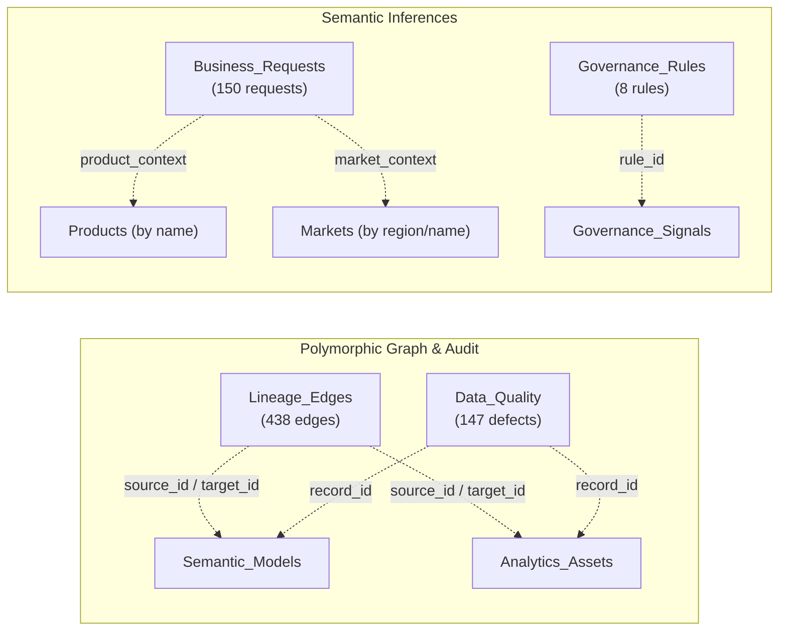

# BIOS — Entity Relationship Diagram (ERD)
## Bayer Pharmaceuticals Builder Data Pack (Since AI 2026)

This document maps all relational structures, foreign key constraints, and semantic associations across the 24 worksheets in the synthetic challenge dataset (`data/source/Bayer_Pharmaceuticals_SinceAI_2026_FINAL_Builder_Data_Pack.xlsx`).

---

## 1. Relational Architecture Overview

The dataset forms an interconnected modular estate centered around **Analytics Assets**, **Semantic Models**, **Governance Rules**, and the **Pharma Commercial Domain**:

- **Core BI Estate**: `Workspaces`, `Owners`, `Semantic_Models`, `Analytics_Assets`.
- **Metrics Governance**: `KPI_Catalog`, `Asset_KPI_Map`.
- **Operational Signals & Audit**: `Asset_Usage`, `Governance_Signals`, `Migration_Backlog`, `Data_Quality`, `Lineage_Edges`.
- **Pharma Business Domain**: `Products`, `Markets`, `Product_Market_Monthly`, `Launch_Milestones`, `Market_Access`, `Supply_Operations`.
- **Request & Policy Engine**: `Business_Requests`, `Governance_Rules`.

---

## 2. Complete Entity-Relationship Diagram (Mermaid)

```mermaid
erDiagram
    %% Core BI Estate
    WORKSPACES ||--o{ SEMANTIC_MODELS : "hosts (workspace_id)"
    WORKSPACES ||--o{ ANALYTICS_ASSETS : "contains (workspace_id)"
    OWNERS ||--o{ SEMANTIC_MODELS : "maintains (owner_id)"
    OWNERS ||--o{ ANALYTICS_ASSETS : "owns [nullable] (owner_id)"
    OWNERS ||--o{ KPI_CATALOG : "governs (owner_id)"
    SEMANTIC_MODELS ||--o{ ANALYTICS_ASSETS : "powers (model_id)"

    %% Metrics Governance
    ANALYTICS_ASSETS ||--o{ ASSET_KPI_MAP : "displays (asset_id)"
    KPI_CATALOG ||--o{ ASSET_KPI_MAP : "mapped_in (kpi_id)"

    %% Telemetry & Signals
    ANALYTICS_ASSETS ||--o{ ASSET_USAGE : "telemetry (asset_id)"
    ANALYTICS_ASSETS ||--o{ GOVERNANCE_SIGNALS : "triggers (asset_id)"
    ANALYTICS_ASSETS ||--o| MIGRATION_BACKLOG : "origin (source_asset_id)"
    SEMANTIC_MODELS ||--o{ MIGRATION_BACKLOG : "target_model (candidate_target_model_id)"

    %% Pharma Business Domain
    PRODUCTS ||--o{ PRODUCT_MARKET_MONTHLY : "measures (product_id)"
    MARKETS ||--o{ PRODUCT_MARKET_MONTHLY : "evaluates (market_id)"
    PRODUCTS ||--o{ LAUNCH_MILESTONES : "schedules (product_id)"
    MARKETS ||--o{ LAUNCH_MILESTONES : "tracks (market_id)"
    PRODUCTS ||--o{ MARKET_ACCESS : "profiles (product_id)"
    MARKETS ||--o{ MARKET_ACCESS : "reimburses (market_id)"
    PRODUCTS ||--o{ SUPPLY_OPERATIONS : "manufactures (product_id)"
    MARKETS ||--o{ SUPPLY_OPERATIONS : "delivers (market_id)"

    WORKSPACES {
        string workspace_id PK
        string workspace_name
        string scope
        string environment
        string platform
        string governance_mode
        string classification
    }

    OWNERS {
        string owner_id PK
        string owner_name
        string role
        string scope
        string status
        string email
    }

    SEMANTIC_MODELS {
        string model_id PK
        string model_name
        string workspace_id FK
        string product_scope
        string region_scope
        string model_type
        string endorsement
        string refresh_frequency
        string refresh_status
        string owner_id FK
        int table_count
        int measure_count
        string ai_readiness
        string ai_issue_pattern
    }

    ANALYTICS_ASSETS {
        string asset_id PK
        string asset_name
        string asset_type
        string platform
        string workspace_id FK
        string model_id FK
        string product_scope
        string market_scope
        string owner_id FK
        datetime created_date
        datetime last_modified
        string lifecycle_status
        string endorsement
        int estimated_audience
        string classification
        string delivery_model
    }

    KPI_CATALOG {
        string kpi_id PK
        string kpi_name
        boolean canonical_metric
        string domain
        string unit
        string definition_status
        string approval_status
        string default_frequency
        string business_criticality
        string owner_id FK
        string description
    }

    ASSET_KPI_MAP {
        string asset_id PK_FK
        string kpi_id PK_FK
        string usage_role
    }

    ASSET_USAGE {
        string asset_id PK_FK
        string month PK
        int views
        int unique_users
        int exports
        int subscriptions
        int avg_load_ms
        int query_errors
    }

    GOVERNANCE_SIGNALS {
        string signal_id PK
        string asset_id FK
        string signal_code
        string severity
        string status
        string detected_by
    }

    MIGRATION_BACKLOG {
        string source_asset_id PK_FK
        string product_scope
        string market_scope
        string recommended_path_candidate
        string candidate_target_model_id FK
        string complexity
        string status
        string synthetic_reason
    }

    PRODUCTS {
        string product_id PK
        string product_name
        string therapeutic_area
        string product_type
        string portfolio_stage
        string commercial_scope
    }

    MARKETS {
        string market_id PK
        string market_name
        string region
        string currency
        string market_maturity
        string regulatory_complexity
    }

    PRODUCT_MARKET_MONTHLY {
        string product_id PK_FK
        string market_id PK_FK
        string month PK
        float net_sales_m_eur_syn
        float forecast_m_eur_syn
        int units_shipped_syn
        float forecast_variance_pct
        float market_access_coverage_pct_syn
        float otif_pct_syn
        float inventory_weeks_syn
        string value_type
    }

    LAUNCH_MILESTONES {
        string milestone_id PK
        string product_id FK
        string market_id FK
        string milestone_type
        datetime milestone_date
        string status
        string business_impact
    }

    MARKET_ACCESS {
        string product_id PK_FK
        string market_id PK_FK
        string reimbursement_status
        string coverage_model
        float coverage_pct_syn
        string trend_status
        string analytics_priority
    }

    SUPPLY_OPERATIONS {
        string product_id PK_FK
        string market_id PK_FK
        string supply_source
        string primary_mode
        float otif_pct_syn
        float inventory_weeks_syn
        float forecast_accuracy_pct_syn
        string risk_status
    }
```

---

## 3. Confirmed Strict Foreign Keys (100% Referential Integrity)

These foreign keys have been verified against the dataset. Zero orphaned or invalid keys were detected:

| Child Table | Foreign Key Column | Parent Table | Primary Key | Total Records | Valid References | Referential Integrity |
|:---|:---|:---|:---|:---:|:---:|:---:|
| `Semantic_Models` | `workspace_id` | `Workspaces` | `workspace_id` | 75 | 75 | **100.0%** |
| `Semantic_Models` | `owner_id` | `Owners` | `owner_id` | 75 | 75 | **100.0%** |
| `Analytics_Assets` | `workspace_id` | `Workspaces` | `workspace_id` | 360 | 360 | **100.0%** |
| `Analytics_Assets` | `model_id` | `Semantic_Models` | `model_id` | 360 | 360 | **100.0%** |
| `Asset_KPI_Map` | `asset_id` | `Analytics_Assets` | `asset_id` | 1,454 | 1,454 | **100.0%** |
| `Asset_KPI_Map` | `kpi_id` | `KPI_Catalog` | `kpi_id` | 1,454 | 1,454 | **100.0%** |
| `Asset_Usage` | `asset_id` | `Analytics_Assets` | `asset_id` | 3,600 | 3,600 | **100.0%** |
| `Governance_Signals` | `asset_id` | `Analytics_Assets` | `asset_id` | 410 | 410 | **100.0%** |
| `Migration_Backlog` | `source_asset_id` | `Analytics_Assets` | `asset_id` | 94 | 94 | **100.0%** |
| `Migration_Backlog` | `candidate_target_model_id` | `Semantic_Models` | `model_id` | 94 | 94 | **100.0%** |
| `KPI_Catalog` | `owner_id` | `Owners` | `owner_id` | 56 | 56 | **100.0%** |
| `Product_Market_Monthly`| `product_id` | `Products` | `product_id` | 980 | 980 | **100.0%** |
| `Product_Market_Monthly`| `market_id` | `Markets` | `market_id` | 980 | 980 | **100.0%** |
| `Launch_Milestones` | `product_id` | `Products` | `product_id` | 35 | 35 | **100.0%** |
| `Launch_Milestones` | `market_id` | `Markets` | `market_id` | 35 | 35 | **100.0%** |
| `Market_Access` | `product_id` | `Products` | `product_id` | 98 | 98 | **100.0%** |
| `Market_Access` | `market_id` | `Markets` | `market_id` | 98 | 98 | **100.0%** |
| `Supply_Operations` | `product_id` | `Products` | `product_id` | 98 | 98 | **100.0%** |
| `Supply_Operations` | `market_id` | `Markets` | `market_id` | 98 | 98 | **100.0%** |

---

## 4. Confirmed Nullable Foreign Keys

| Child Table | Foreign Key Column | Parent Table | Primary Key | Total Records | Valid | Null Count (%) | Governance Reason |
|:---|:---|:---|:---|:---:|:---:|:---:|:---|
| `Analytics_Assets` | `owner_id` | `Owners` | `owner_id` | 360 | 339 | **21 (5.8%)** | Deliberately injected unowned assets to evaluate enforcement of **RULE-003** (*Owner required*). |

---

## 5. Inferred & Polymorphic Relationships

These associations represent semantic graph edges or audit mappings that do not use standard single-table foreign key constraints:



### 5.1 Polymorphic Lineage Graph (`Lineage_Edges`)
- **Node Universe**: Source and target nodes reference either a `Semantic_Models.model_id` or an `Analytics_Assets.asset_id`.
- **Verified Breakdown**:
  - `MODEL_TO_ASSET` (360 edges): Strict 1:1 mapping from each `Semantic_Model` to its downstream `Analytics_Asset`.
  - `ASSET_TO_ASSET` (56 edges): Composite lineage from Workbooks/Reports into Dashboards and Apps.
  - `MODEL_TO_MODEL` (22 edges): Multi-tier dependency where domain models inherit from enterprise shared models.
- **Graph Coverage**: 360 of 360 assets are connected. 74 of 75 semantic models are connected. Exactly 1 model (`SM-009`) is an isolated orphan node.

### 5.2 Polymorphic Audit Defects (`Data_Quality`)
- **`record_id` Mapping**:
  - 126 records reference `Semantic_Models.model_id` (issues with `ai_readiness`, `ai_issue_pattern`, or `refresh_status`).
  - 21 records reference `Analytics_Assets.asset_id` (all 21 unowned assets missing `owner_id`).

### 5.3 Request Intent Extraction (`Business_Requests`)
- `product_context`: Matches `Products.product_name` (e.g., 'Nubeqa', 'Kerendia', 'Lynkuet') or 'All Pharma'.
- `market_context`: Matches `Markets.region` (e.g., 'EMEA') or `Markets.market_id` (e.g., 'US', 'JP', 'DE').
- Used by BIOS NLP parser to extract structured intent and filter candidate assets before triggering governance rules.

---

## 6. Relational Cardinality Summary

| Relationship | Type | Parent | Child | Business Semantic |
|:---|:---:|:---|:---|:---|
| Workspaces to Semantic Models | `1 : N` | `Workspaces` | `Semantic_Models` | A workspace hosts multiple semantic models. |
| Workspaces to Analytics Assets | `1 : N` | `Workspaces` | `Analytics_Assets` | A workspace publishes multiple reports/dashboards. |
| Owners to Semantic Models | `1 : N` | `Owners` | `Semantic_Models` | A steward maintains technical models. |
| Owners to Analytics Assets | `1 : N (nullable)` | `Owners` | `Analytics_Assets` | A business custodian owns production reports. |
| Owners to KPI Catalog | `1 : N` | `Owners` | `KPI_Catalog` | A domain lead approves canonical metric definitions. |
| Semantic Models to Analytics Assets | `1 : N` | `Semantic_Models` | `Analytics_Assets` | A shared model powers multiple visual reports. |
| Analytics Assets to Asset KPI Map | `1 : N` | `Analytics_Assets` | `Asset_KPI_Map` | An asset visualizes multiple mapped KPIs. |
| KPI Catalog to Asset KPI Map | `1 : N` | `KPI_Catalog` | `Asset_KPI_Map` | A metric is reused across multiple reports. |
| Analytics Assets to Asset Usage | `1 : N` | `Analytics_Assets` | `Asset_Usage` | An asset accumulates 10 monthly usage records. |
| Analytics Assets to Governance Signals | `1 : N` | `Analytics_Assets` | `Governance_Signals` | An asset triggers multiple governance flags. |
| Analytics Assets to Migration Backlog | `1 : 1` | `Analytics_Assets` | `Migration_Backlog` | A legacy Tableau asset has exactly one migration item. |
| Semantic Models to Migration Backlog | `1 : N` | `Semantic_Models` | `Migration_Backlog` | A target Power BI model is designated for migration. |
| Products & Markets to Facts | `1 : N` | `Products`, `Markets` | `Product_Market_Monthly`, `Launch_Milestones`, `Market_Access`, `Supply_Operations` | Dimension keys segment commercial and operational fact logs. |

