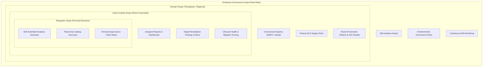
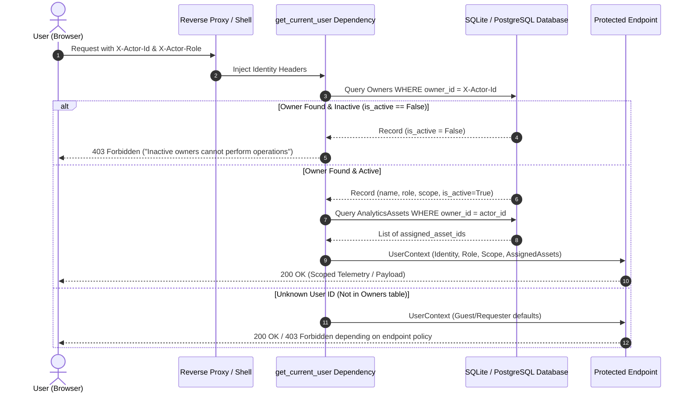

# BIOS Organizational Access & Hierarchical Governance Model

**Classification:** Enterprise Security Architecture Specification  
**Version:** 1.0.0  
**Scope:** BIOS (Business Intelligence Optimization System)  
**Document Code:** SEC-ARCH-ORG-001

---

## 1. Architectural Philosophy & Principles

The BIOS access control model reflects the governance and operational structure of a regulated enterprise pharmaceutical organization (such as Bayer). It combines:

1. **Role-Based Access Control (RBAC)**: Defines functional capabilities and permissible operations across the system.
2. **Hierarchical Scope Boundaries**: Constrains the operational horizon (Enterprise, Domain, Asset, Requester) to enforce the principle of least privilege.
3. **Data-Layer Query Scoping**: Prevents cross-tenant and cross-custody data leakage at the SQL database layer.
4. **Separation of Duties & Anti-Collusion**: Guarantees that no single individual or autonomous AI agent can self-approve waivers or release ungoverned analytics assets.
5. **Deny-by-Default Architecture**: Treats the frontend UI as an untrusted client; all security decisions are evaluated deterministically in the FastAPI service layer.

---

## 2. Hierarchical Scope Taxonomy

BIOS organizes data custody and governance authority into four concentric hierarchical tiers:

### 2.1 Requester Scope (`REQUESTER` / `ANALYST`)
- **Focus**: Needs discovery, conversational requirements elicitation via the 6-agent AI Assistant, and tracking of personal requests.
- **Data Boundary**: Requesters can view the general analytics portfolio to promote reuse, but have zero visibility into operational governance findings, system alerts, lifecycle health scores, or development studio artifacts.
- **Approvals Boundary**: Can query `/api/v1/approvals`, but the backend strictly limits the returned dataset to records where `requester_id == actor_id`. Requests submitted by others remain invisible and inaccessible (HTTP 403 upon direct ID query).

### 2.2 Asset Custody Scope (`ASSET_OWNER`)
- **Focus**: Stewardship and operational health of assigned business intelligence products.
- **Data Boundary**: Automatically scoped to assets where `owner_id == user.actor_id` or `business_owner == user.actor_name` (e.g. `OWN-001` Nina Garcia owning 9 distinct reporting assets).
- **Remediation Boundary**: Can view and acknowledge alerts and governance findings targeting owned assets. Blocked from enterprise-wide governance evaluations or compilation of Power BI semantic models in Development Studio.

### 2.3 Domain Scope (`DOMAIN_STEWARD`)
- **Focus**: Cross-asset semantic coherence, KPI consistency, and business logic harmonization across a therapeutic area or functional domain (e.g. Oncology, Cardiology, Commercial EMEA, Supply Chain).
- **Data Boundary**: Scoped to the assets and models associated with the steward's organizational unit.
- **Artifact Generation**: Authorized to access the Power BI Artifact Factory (`/artifacts`), generating PBIP/PBIR tabular models, DAX measures, and JSON metadata.

### 2.4 Enterprise Governance Scope (`BI_GOVERNANCE_REVIEWER`)
- **Focus**: Fleet-wide compliance, regulatory auditability, rule waiver adjudication, and continuous drift telemetry across all 360 catalog assets.
- **Governance Power**: Full visibility over all findings, lifecycle migration metrics, and telemetry streams.
- **Infrastructure Isolation**: Strictly excluded from platform configuration (`/admin`) and external connector secrets (`/integrations`).

### 2.5 Platform Administration (`BIOS_ADMIN`)
- **Focus**: System infrastructure, database migrations, service-principal credentials (Microsoft Entra ID, Tableau PAT), and diagnostic telemetry.
- **Authority**: Possesses unrestricted administrative privileges across all workspaces and APIs.

---

## 3. Live Database Owner Verification

Rather than relying on unverified claims in client tokens, BIOS resolves user identities against the authoritative `Owners` table in the core database:

### Database Schema Alignment
The database `Owners` entity enforces:
- `owner_id`: Primary key identifier (e.g., `OWN-001`).
- `owner_name`: Authoritative full name (e.g., `Nina Garcia`).
- `email`: Corporate email address (`nina.garcia@bayer.com`).
- `role`: Organizational position (`Commercial Analytics Lead`).
- `scope`: Geographic / business scope (`Global`, `EMEA`, `Latin America`).
- `is_active`: Boolean flag; deactivated personnel are blocked across all operations.

---

## 4. Separation of Duties & Anti-Self-Approval

To prevent conflicts of interest and regulatory non-compliance in enterprise analytics change management:

1. **Anti-Self-Approval Safeguard (`RULE-SEC-001`)**:
   - When an approval request is adjudicated via `POST /api/v1/approvals/{id}/approve`, the backend compares `user.actor_id` and `user.actor_name` against the ticket's `requester_id` and `requester_name`.
   - If they match, the request is aborted with `HTTP 403 Forbidden: Anti-self-approval violation: Requesters cannot approve their own requests`.
2. **AI Agent Self-Approval Ban (`RULE-SEC-002`)**:
   - Autonomous AI agents (Request Router, Asset Lookup, Solution Architect, Governance Officer, Decision Agent) cannot act as the final adjudicator. Human approval is deterministically required for all consequential lifecycle promotions, retirements, or waivers.
3. **Separation of Governance and Infrastructure (`RULE-SEC-003`)**:
   - Governance reviewers who evaluate compliance have zero write or read access to database connection strings, OAuth tokens, or platform system settings.

---

## 5. Client Session State & Dynamic Persona Switcher

For enterprise evaluation, audit simulation, and cross-role validation:

- **Persona Switcher**: Located in the application Header, the switcher allows authorized users to inspect the interface from any of the five enterprise viewpoints.
- **Session Persistence**: Persona selections are persisted in browser `sessionStorage` (`bios_actor_id`, `bios_actor_role`).
- **Automatic Header Injection**: The frontend HTTP client (`frontend/lib/api.ts`) automatically intercepts outgoing requests and adds `X-Actor-Id` and `X-Actor-Role` headers.
- **Client Route Interception**: `frontend/components/layout/Shell.tsx` evaluates `isRouteAuthorized(pathname, role)`. If a user attempts to navigate directly to an unauthorized URL, the application renders a security barrier banner explaining the restriction without leaking sensitive page data.

